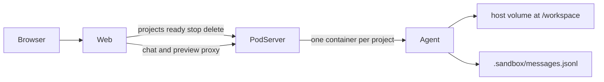
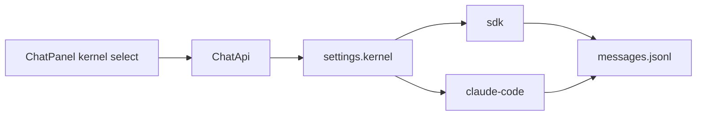

# 架构

本文描述当前系统行为（含第三期双对话内核）。本地怎么跑见 [runbook.md](./runbook.md)；迁了什么、故意没迁什么见 [migrations/](./migrations/)。

## 总览

三个进程，没有登录，租户就是项目 ID。



| 进程 | 默认端口 | 职责 |
|---|---|---|
| Web (`apps/web`) | `3000` | 浏览器 UI；项目 CRUD / 聊天 / 预览都转发到 pod-server；自己不存项目库 |
| pod-server (`apps/pod-server`) | `7000` | Docker 生命周期、JSON 注册表、反代 `/p/:id/agent` 与 `/p/:id/preview` |
| Agent（容器内） | 容器内 `4000` / `8000` | 对话 API、工作区工具、预览服务 |

## 请求路径

### 项目生命周期

浏览器 → Web `/api/projects*` → pod-server 同名路由。

| Web | pod-server | 作用 |
|---|---|---|
| `GET/POST /api/projects` | 同路径 | 列表 / 创建 |
| `GET /api/projects/:id/ready` | 同路径 | 容器在跑则返回；已停则 `docker start` 后再返回 |
| `POST /api/projects/:id/stop` | 同路径 | `docker stop`，卷保留 |
| `DELETE /api/projects/:id` | 同路径 | 删容器和卷 |
| `GET /api/projects/:id/messages` | 经 `/p/:id/agent/api/messages` | 读卷内聊天历史 |
| `GET/PATCH /api/projects/:id/settings` | 经 `/p/:id/agent/api/settings` | 读/改项目内核 |
| `GET /api/projects/:id/kernels` | 经 `/p/:id/agent/api/kernels` | 内核列表与是否可用 |
| `POST /api/projects/:id/answer` | 经 `/p/:id/agent/api/answer` | claude-code 内核的 AskUserQuestion 答案 |

实现入口：[apps/web/lib/pod.ts](../apps/web/lib/pod.ts)、[apps/pod-server/src/index.ts](../apps/pod-server/src/index.ts)、[apps/pod-server/src/projects.ts](../apps/pod-server/src/projects.ts)。

### 聊天

1. Web `POST /api/chat`，body 带 `projectId` 与 AI SDK 消息。
2. Web 先 `ready` 该项目，再转发到 pod-server `/p/:id/agent/api/chat`。
3. pod-server 用 `docker inspect` 查容器临时宿主端口，反代到容器内 Agent。
4. Agent 读 `.sandbox/settings.json` 的 `kernel`，分发给 `sdk` 或 `claude-code` 内核。

浏览器不直接连容器端口。见 [apps/web/app/api/chat/route.ts](../apps/web/app/api/chat/route.ts)、[apps/pod-server/src/proxy.ts](../apps/pod-server/src/proxy.ts)、[apps/agent/src/chat.ts](../apps/agent/src/chat.ts)。

### 预览

预览 iframe 的 src 是 Web `/api/preview/:id`（可带子路径）。Web 同样先 `ready`，再转发到 `/p/:id/preview`。见 [apps/web/app/api/preview/[id]/[[...path]]/route.ts](../apps/web/app/api/preview/[id]/[[...path]]/route.ts)。

## 隔离与持久化

### 一项目一容器一卷

创建项目时：

1. 生成 id，在宿主写卷目录，默认 `apps/pod-server/data/volumes/<id>`（可用 `POD_DATA_DIR` 改根目录）。
2. `docker run` Agent 镜像，挂载该目录到 `/workspace`，容器名 `as-agent-<id>`。
3. 把项目记录写入 `apps/pod-server/data/registry/projects.json`。

对外稳定 URL 是 `/p/:id/agent` 与 `/p/:id/preview`，由 [apps/pod-server/src/registry.ts](../apps/pod-server/src/registry.ts) 拼出。容器内 `AGENT_PORT` / `PREVIEW_PORT` 映射到宿主临时端口，反代时再解析。

### 工作区路径约束

工具收到的路径经 [apps/agent/src/workspace.ts](../apps/agent/src/workspace.ts) 解析，逃出 `/workspace` 会直接报错。

### 密钥

`ANTHROPIC_API_KEY` 等模型凭证只在 `docker run` 时从宿主机环境注入（见 [apps/pod-server/src/docker.ts](../apps/pod-server/src/docker.ts)），不写进镜像层。

### 生命周期语义

| 操作 | 容器 | 卷与 `.sandbox/*` |
|---|---|---|
| `stop` | 停止 | 保留（含 messages.jsonl、settings.json） |
| `ready`（已停） | 再启动同一容器 | 同一卷 |
| `delete` | 删除 | 删除该项目卷 |

`ready` 只做 `docker start`，不会换成新镜像。改 Agent 源码后要重建镜像，并对已有项目删容器后重建，或新建项目。细节见 [runbook.md](./runbook.md)。

### 项目设置

`/workspace/.sandbox/settings.json`（[apps/agent/src/settings.ts](../apps/agent/src/settings.ts)）：

```json
{ "kernel": "sdk", "claudeSessionId": null }
```

- `kernel`：`sdk` | `claude-code`
- `claudeSessionId`：claude-code 会话 resume 用；切内核时清空
- 环境变量 `AGENT_KERNEL` 只影响**尚无该文件**时的初始值

## 对话循环



[apps/agent/src/chat.ts](../apps/agent/src/chat.ts) 读 settings 后分发到内核实现。ChatPanel 空闲时可 `PATCH` 切换；对话进行中返回 409。

| 内核 | 实现 | AskUserQuestion |
|---|---|---|
| `sdk`（默认） | [kernels/sdk.ts](../apps/agent/src/kernels/sdk.ts)：`streamText` + 自定义工作区工具 | 无 `execute`；前端 `addToolOutput` |
| `claude-code` | [kernels/claude-code.ts](../apps/agent/src/kernels/claude-code.ts)：`ai-sdk-provider-claude-code`，`cwd=/workspace` | `canUseTool` + `waitForAnswer`；前端 `POST .../answer` |

`GET /api/kernels` 返回两套内核的 `id/label/available/reason`（缺 `ANTHROPIC_API_KEY` 时均不可用）。

### sdk 内核

工作区工具（[apps/agent/src/tools.ts](../apps/agent/src/tools.ts)）：

| 工具 | 作用 |
|---|---|
| `Read` / `Write` / `Edit` | 读改工作区文件 |
| `Bash` | 在工作区内执行命令 |
| `Glob` / `Grep` | 列举与搜索 |
| `AskUserQuestion` | 向用户提问；**不提供 `execute`**，流停在待回答的 tool part |

系统提示要求：需要真实产品/设计选择时才问；不要输出 `switch-agent`。

Web [sandbox-shell.tsx](../apps/web/components/sandbox-shell.tsx) 用 `addToolOutput` 提交答案；工具结果齐了由 `sendAutomaticallyWhen` 再发一轮。

### claude-code 内核

薄封装，不搬 Rush 企业版 ClaudeCodeV2Provider。

- `permissionMode: 'acceptEdits'`，`settingSources: []`，允许 Read/Write/Edit/Bash/Grep/LS/AskUserQuestion
- 有 `claudeSessionId` 则 resume；没有则开新 session，并把最近若干轮 jsonl 压成纯文本前缀塞进 system，避免切内核后失忆
- AskUserQuestion 在 provider 内执行：`canUseTool` 调用 [ask-user-state.ts](../apps/agent/src/ask-user-state.ts) 的 `waitForAnswer`；UI 对应该内核时 `fetch` Web `/api/projects/:id/answer`，不能走 `addToolOutput`

### AskUserQuestion（共用 UI）

- 卡片可见后 30 秒无操作，提交「用户未回答，请自行决定」并继续。
- 选项上的 `switch-agent` action 只当普通选项，不切换 Agent / 内核。
- 提问卡实现：[packages/ai-components/.../ask-user-question-tool.tsx](../packages/ai-components/src/rush-v2-chat/tools/ask-user-question-tool.tsx)。

### 消息持久化

客户端 transcript 为准：每次 chat 先 `replaceMessages(incoming)`，流结束后再把完整 UIMessage（含 tool parts）写回 `/workspace/.sandbox/messages.jsonl`（[apps/agent/src/messages.ts](../apps/agent/src/messages.ts)）。两套内核共用同一文件。刷新页面后 Web 拉 `/api/projects/:id/messages` 恢复历史与工具卡。

## 预览闭环

Agent 内预览监督（[apps/agent/src/preview.ts](../apps/agent/src/preview.ts)）：

1. 启动时先 reconcile；没有合适的 npm 脚本则起静态文件服务，必要时写出默认 `index.html`。
2. `Write` / `Edit` / `Bash` 结束后 `scheduleReconcilePreview()`（合并短时间内的多次写入）。
3. 有 `package.json` 的 `dev` / `start` / `preview` **且** 已有 `node_modules`：关掉静态服务，用 `HOST=0.0.0.0` 与预览端口拉起对应脚本；同一脚本已在跑则不重启。
4. 不满足上述条件：回到或保持静态服务。

Web [preview-panel.tsx](../apps/web/components/preview-panel.tsx) 在对话从 `streaming` / `submitted` 回到 `ready` 时重载 iframe；手动 Refresh 仍可用。

## UI 包

| 包 | 角色 |
|---|---|
| `@cortex/ui` | shadcn/ui 原语 + Tailwind v4 theme；本仓带 Storybook |
| `@cortex/ai-components` | 聊天元素、`PartRenderer`、工具卡（`rush-v2-chat`） |
| `@cortex/shared` | 薄类型 / 工具 shim，只满足上面组件的 import |

Web 壳是三栏：[sandbox-shell.tsx](../apps/web/components/sandbox-shell.tsx)（侧栏 / 对话 / 预览）。Web 使用 AI SDK v6。

## 当前不做

- 登录、多用户、Cookie / CAS
- MCP、Skills、记忆、Gemini 多模型路由
- K8s / 外部 Pod 平台
- 企业版完整 ChatView、Lexical 富文本、Agent 市场、`switch-agent`
- 多会话（仍是一项目一对话）
