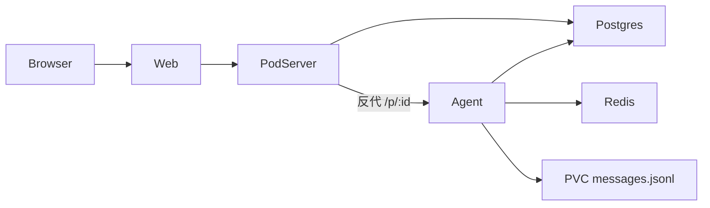
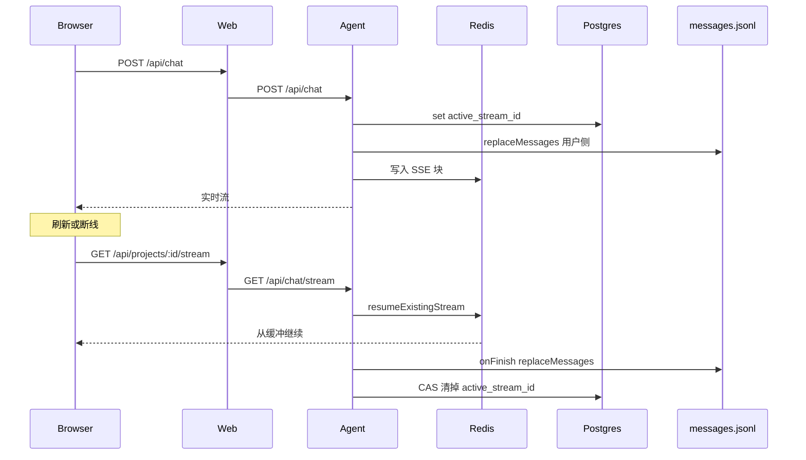

# 数据库与断流续传

已落地。设置 `DATABASE_URL` 后控制面走 PostgreSQL；再设置 `REDIS_URL` 后，进行中的聊天 SSE 可以在刷新后续上。两个变量都缺省时，行为与以前相同：JSON 注册表、断开后只读 jsonl。见 [architecture.md](./architecture.md)。

Rush 把用户和项目放在 PostgreSQL（`USER_POSTGRESQL_URL` / `RUSH_POSTGRESQL_URL`），把可恢复流放在 Redis（`resumable-stream/ioredis`），并用会话上的 `active_stream_id` 告诉前端能不能续。本方案沿用这个分工，收成一套库、一台 Redis，不搬 CAS、OSS、Sentinel 和双库。

## 结论

两套存储，各管一件事：

| 存储 | 放什么 | 不放什么 |
|---|---|---|
| PostgreSQL | 组织、用户、会话、邀请码、项目元数据、`active_stream_id` | 聊天正文、MCP、Skills、记忆、工作区文件 |
| Redis | 进行中的 UI Message SSE 缓冲，供断线后续上 | 用户、项目、历史消息 |
| 项目 PVC | `.sandbox/messages.jsonl` 仍是聊天正文的事实来源 | 控制面 |

断线不取消这一轮生成。Agent 把 SSE 块同时写进 Redis。浏览器刷新或重连时，按项目上的 `active_stream_id` 从 Redis 把还没结束的流接回去；流已经结束或 Redis 里没有了，就清掉指针，改读 jsonl。

显式停止（用户点 Stop）才 abort 生成。关掉标签、刷新、网络闪断都只是丢掉这一条 HTTP，不打断模型和工具。

## 目标

- pod-server 重启不丢用户、组织和项目归属。多进程以后可以共读同一份库（池锁仍先留在单进程）。
- 刷新页面后，若这一轮还在跑，聊天从断开位置继续出字，而不是只看到开聊前写进 jsonl 的用户消息。
- Redis 或 Postgres 不可用时，创建项目和聊天退回今天的行为：无续传，jsonl 仍落盘。不让续传变成聊天的硬依赖。
- 跨组织访问项目和流都是 404。

## 非目标

- 第二套用户库、Supabase、行级安全。一个 `DATABASE_URL`。
- Redis Sentinel。本地和当前集群用单实例；挂了就关闭续传。
- 把 `messages.jsonl`、MCP、Skills、`MEMORY.md` 迁进数据库。工作区文件保持第五期的布局。
- OSS 冷备、向量检索、消息全文搜索。
- 客户端断开时取消 `streamText`。那是 Stop，不是续传。
- 一个项目多会话。仍是一项目一条消息历史、最多一条活跃流。

## 数据模型

库名 `agent_sandbox`。表由 pod-server 启动时执行 SQL 迁移（`apps/pod-server/migrations/*.sql`），不引入 ORM。驱动用 `pg`。

```text
orgs
  id text pk
  name text not null
  created_at timestamptz not null

users
  id text pk
  email text not null unique
  password_hash text not null
  org_id text not null references orgs(id)
  role text not null check (role in ('owner','member'))
  created_at timestamptz not null

sessions
  id text pk
  token_hash text not null unique
  user_id text not null references users(id)
  expires_at timestamptz not null

invites
  id text pk
  code_hash text not null unique
  org_id text not null references orgs(id)
  created_by text not null references users(id)
  expires_at timestamptz not null

projects
  id text pk
  org_id text not null references orgs(id)
  name text not null
  status text not null
  release_name text not null
  volume_path text not null
  active_stream_id text
  active_stream_started_at timestamptz
  created_at timestamptz not null
  updated_at timestamptz not null
  last_error text
```

`projects.active_stream_id` 是「现在有没有一条还能续的流」的索引，不是块存储。块在 Redis，键前缀 `resumable-stream:rs:<streamId>`，TTL 15 分钟（库默认）。流正常结束、Redis 判定过期、或用户 Stop 时，用下面的条件更新清掉指针，避免清掉刚建的下一条流：

```sql
update projects
set active_stream_id = null,
    active_stream_started_at = null,
    updated_at = now()
where id = $projectId
  and active_stream_id = $expectedStreamId;
```

K8s 的 Deployment / Service / PVC 仍是运行时事实来源。库里的 `status`、`release_name`、`volume_path` 只服务列表和鉴权，和现在的 `projects.json` 字段一一对应。池成员（idle / creating）继续只活在 Deployment 标签和 `registry/pool.json`，不入库。空闲 Pod 没有组织，领用时才插入 `projects` 行。

### 从 JSON 迁入

一次性脚本 `pnpm --filter @agent-sandbox/pod-server migrate-registry`：

1. 读 `registry/users.json`、`orgs.json`、`sessions.json`、`invites.json`、`projects.json`。
2. 按外键顺序插入。`on conflict (id) do nothing`，可重复跑。
3. 没有 `orgId` 的旧项目跳过，并打印 id。不自动归给某个组织。
4. 成功后 pod-server 只读写 Postgres。JSON 留在磁盘上当备份，不再作为读路径。

密码哈希和 token 哈希原样搬，用户不用重设密码。未过期的 `as_session` cookie 继续有效。

## 进程怎么接库



| 进程 | Postgres | Redis |
|---|---|---|
| pod-server | 用户、组织、会话、邀请、项目 CRUD | 不连 |
| Agent | 只读写本 `PROJECT_ID` 的 `active_stream_id` | 发布和恢复 SSE |
| Web | 不连 | 不连。cookie 不变，Bearer 仍打到 pod-server |

连接串来自 Secret `agent-env` 之外的新 Secret `sandbox-data`，以免模型密钥和数据库口令搅在一起：

| 变量 | 谁用 | 默认 |
|---|---|---|
| `DATABASE_URL` | pod-server、Agent | 无。未设置时 pod-server 继续用 JSON，Agent 不写 `active_stream_id` |
| `REDIS_URL` | Agent | 无。未设置时不包 resumable-stream，SSE 行为与现在一致 |

本地 OrbStack 各加一个 Deployment：`postgres:16`（PVC 存数据）和 `redis:7`（空盘可丢，丢了只影响还没结束的流）。不进 Pod 池，不按项目复制。

pod-server 的注册表读写从 [`registry.ts`](../apps/pod-server/src/registry.ts) / [`auth.ts`](../apps/pod-server/src/auth.ts) 换成同一组函数签名的 `pg` 实现。HTTP 路由和 Web cookie 不动。`DATABASE_URL` 为空时走现有 JSON，测试默认这条路径。

## 断流续传

现状：浏览器 `useChat` → Web `POST /api/chat` → pod-server 透传 → Agent `createUIMessageStreamResponse`。客户端 abort 没有往上传。生成多半会跑完，但块已经写进关掉的连接，刷新只能读 jsonl，进行中的 assistant 会缺一截。

续传加在 Agent 出口，不改模型循环。



### 开始一轮

[`sdk.ts`](../apps/agent/src/kernels/sdk.ts) 和 [`claude-code.ts`](../apps/agent/src/kernels/claude-code.ts) 在 `createUIMessageStream` 之外包一层：

1. 生成 `streamId`（nanoid）。若该项目已有未过期的 `active_stream_id`，拒绝新的 POST，返回 409。一项目一条活跃流。
2. `UPDATE projects SET active_stream_id = $id WHERE id = $project AND active_stream_id IS NULL`。更新行数为 0 则同样 409。
3. `REDIS_URL` 存在时，用 `resumable-stream` 的 `createNewResumableStream(streamId, () => uiStream)` 作为 HTTP body。不存在时直接返回现在的 `createUIMessageStreamResponse`。
4. 开聊时的 `replaceMessages(incoming)` 保持不变，用户消息先落盘。

生成循环不订阅请求的 abort。Redis 写入失败只打日志，实时 SSE 照常吐给还连着的客户端。

### 接回去

新增：

| Web | Agent | 作用 |
|---|---|---|
| `GET /api/projects/:id/stream` | `GET /api/chat/stream` | 有活跃流则返回 `text/event-stream`，否则 **204** |
| `GET /api/projects/:id/stream/status` | `GET /api/chat/stream/status` | `{ activeStreamId, canResume }` |

Web 这两条仍走现有 Bearer 反代，pod-server 先按 `orgId` 确认项目存在。Agent 只处理自己的 `PROJECT_ID`。

恢复步骤：

1. 读本项目 `active_stream_id`。空则 204。
2. `resumeExistingStream(streamId)`。得到流就原样返回，响应头仍是 AI SDK UI Message Stream v1，这样 `useChat` 能接着拼 parts。
3. 库返回空、或 `hasExistingStream` 是 `null` / `"DONE"`：执行上面的 CAS 清指针，返回 204。前端随后拉 `GET .../messages`，以 jsonl 为准。
4. Redis 抛错：不清指针，返回 503。下一轮心跳再试。避免 Redis 抖动时把还在跑的流标没。

前端 [`sandbox-shell.tsx`](../apps/web/components/sandbox-shell.tsx) 把 `useChat` 的 `resume` 设为 true。AI SDK 会在加载该 chat id 时请求 `GET /api/chat/:id/stream`。这里 chat id 是 `projectId`，所以 Web 增加一条别名路由 `GET /api/chat/:projectId/stream`，转到上面的项目流接口。204 时维持今天的行为：只显示 jsonl 历史。

进页面时先 `GET .../stream/status`。`canResume: true` 才发起 resume，避免对每只已结束的项目打一条必失败的流请求。

### 结束和停止

`onFinish` 里顺序固定：

1. `replaceMessages(messages)` 把完整回合写入 jsonl。
2. CAS 清 `active_stream_id`。
3. `finishBusy()`、关闭 MCP。

用户 Stop：Web `POST /api/projects/:id/chat/stop` → Agent abort 当前 `streamText` 的 `AbortController`（这是本方案新增的、唯一会取消生成的信号）。abort 后走同一套 `onFinish`，jsonl 里是停下来的那一截，指针清掉。Redis 里剩余的块不再被续上。

进程被杀掉、还没跑到 `onFinish` 时，指针会残留。这就是 Rush 里 `active_stream_id` 把前端卡死的原因。Agent 启动时先清掉本 `PROJECT_ID` 的指针：上一进程里的 `streamText` 已经没了，Redis 里剩下的块也无法再被写完。处理方式：

- status / resume 时用 `hasExistingStream` 区分「还在」「已结束」「键没了」。
- 键没了或已结束就 CAS 清指针，前端读 jsonl。jsonl 可能缺最后一截，接受这个缺口，不从 Redis 回放进文件。Redis 只服务还活着的连接。
- 另外一个 60 秒定时器：`active_stream_started_at` 超过 15 分钟且 Redis 无此键，同样清掉。

### 和现有断开行为的差别

| | 现在 | 本方案 |
|---|---|---|
| 断线后生成 | 继续，块被丢掉 | 继续，块进 Redis |
| 刷新 | 只读 jsonl，进行中的回复缺失 | 流还在则接上；否则读 jsonl |
| Stop | 无 | abort 这一轮 |
| 忙状态 | 消费者 cancel 可能提前 `finishBusy` | `finishBusy` 只在 `onFinish` 或 Stop | 
| 历史正文 | jsonl | 仍是 jsonl |

## 失败

| 情况 | 行为 |
|---|---|
| 未配置 `DATABASE_URL` | 控制面保持 JSON。不写 `active_stream_id` |
| 未配置 `REDIS_URL` | 聊天与现在相同，resume 接口恒为 204 |
| Postgres 在控制面请求中失败 | 该请求 500。不回写 JSON |
| 聊天领取 `active_stream_id` 失败 | 这一轮仍流式返回，只是不记指针、不能续传 |
| 领用 Pod 后插入项目行失败 | 与现在写注册表失败相同：删掉这套 Release，不把 Pod 标回 idle |
| Redis 在生成中失败 | 当前连接继续收 SSE；新来的 resume 得到 503 或 204（键不存在时清指针） |
| 两个标签同时 POST | 条件更新保证只有一个 `active_stream_id`，另一个 409 |
| 跨组织 GET stream | pod-server 404，Agent 收不到 |

## 落地顺序

以下步骤已经做完。未配置 `DATABASE_URL` / `REDIS_URL` 时仍走降级路径。

1. Postgres Deployment、`DATABASE_URL`、SQL 迁移、JSON 导入。pod-server 的 auth / projects 改读库，`DATABASE_URL` 为空仍走 JSON。
2. Redis Deployment。Agent 在有 `REDIS_URL` 时包上 resumable-stream，并维护 `active_stream_id`。
3. Web 的 resume 路由和 `useChat({ resume: true })`，加上 Stop。
4. 文档把 [architecture.md](./architecture.md) 里「JSON 注册表、无续传」改成上述行为。未配置两个 URL 的段落保留为降级说明。

## 验收

- 两个组织的用户和项目在 Postgres 里隔离；导入后旧 cookie 仍能登录。
- `DATABASE_URL` 未设置时，现有 pod-server 测试仍全部通过。
- 生成过程中刷新：同一 `streamId` 的后续块出现在新页面上，且不会另起一轮。
- 生成结束后再刷新：resume 为 204，消息与 jsonl 一致，`active_stream_id` 为空。
- 杀掉 Agent 进程后再打开：指针被清掉，页面不再停在 Disconnected；已落盘的消息仍在。
- Stop 后工具不再继续执行，resume 为 204。
- Redis 关掉后，新的聊天仍能流式返回，只是刷新接不回去。
