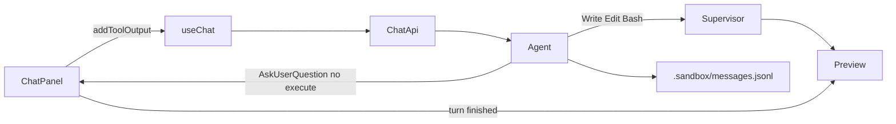

# 第二期：编码体验闭环

对应提交 `b2b953f`（`feat: close coding loop with AskUserQuestion and live preview reconcile`）。

第一期的 Docker 隔离与聊天壳保持不动。这一期让「提问 → 继续改文件 → 预览变掉 → 刷新还能看见」成立。机制说明见 [architecture.md](../architecture.md) 的对话与预览两节。

## 目标

沙盒里补上编码闭环，不迁 MCP、Skills、记忆、K8s，也不接企业的切 Agent / answer 接口。

## 结果

### AskUserQuestion

- Agent 增加无 `execute` 的 `AskUserQuestion`，schema 对齐 `@cortex/shared` 的提问类型。
- 系统提示：只有需要真实选择时才问；禁止 `switch-agent`。
- Web 用 `addToolOutput` 交答案；工具结果齐了由 `sendAutomaticallyWhen` 自动再发一轮。
- 提问卡在沙盒模式走 `onAskUserAnswer` 回调。企业版卡片从 `/next/:id` 取 projectId 再 POST 企业 answer 接口的路径，在沙盒里永远不成立，这一期用客户端工具结果接上，不改成企业协议。
- 卡片可见后 30 秒无操作 → 提交「用户未回答，请自行决定」。
- 带 `switch-agent` 的选项只当普通选项。

### 预览跟着工作区变

原先预览只在进程启动时看一次 `package.json`，写成 Vite 项目后静态服务仍占着端口。

- `Write` / `Edit` / `Bash` 后 `scheduleReconcilePreview()`。
- 没有合适的 npm 脚本或还没有 `node_modules`：继续静态服务。
- 有 `dev` / `start` / `preview` 且依赖已装：切到该脚本；同一脚本已在跑则不重启。
- 对话回合从 streaming 回到 ready 时，Web 重载预览 iframe。

### 刷新后工具卡还在

`onFinish` 把完整 UIMessage（含 tool parts 与提问结果）写回 jsonl；补充往返测试，确认 `loadMessages` 后 part 类型和输出都还在。

## 明确没做

- MCP、Skills、记忆、Gemini、K8s
- 搬 Rush 的 `ask-user-state.ts`、`/api/ai-stream-v2/answer`、`switch-agent`
- 把沙盒提问改成企业 answer 协议

## 关键路径

- [apps/agent/src/tools.ts](../../apps/agent/src/tools.ts) — `AskUserQuestion`；`Write`/`Edit`/`Bash` 触发 reconcile
- [apps/agent/src/preview.ts](../../apps/agent/src/preview.ts) — 预览监督
- [apps/agent/src/chat.ts](../../apps/agent/src/chat.ts) / [messages.ts](../../apps/agent/src/messages.ts) — 流式与 jsonl
- [apps/web/components/sandbox-shell.tsx](../../apps/web/components/sandbox-shell.tsx) — `addToolOutput`
- [apps/web/components/preview-panel.tsx](../../apps/web/components/preview-panel.tsx) — 回合结束重载
- [packages/ai-components/.../ask-user-question-tool.tsx](../../packages/ai-components/src/rush-v2-chat/tools/ask-user-question-tool.tsx)

## 验收（当时）

- 二选一提问 → 点选项后按该选项改文件
- 静态 `index.html` 在回合结束后更新；写出带 `dev` 的项目并装好依赖后，预览切到 dev server；另一项目不受影响
- 刷新后 Write 卡片与已提交提问仍在
- `pnpm --filter @agent-sandbox/agent test` 与 typecheck 通过；Agent 改动后需重建镜像（见 [runbook](../runbook.md#agent-镜像)）
