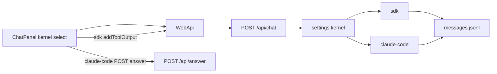

# 第三期：双对话内核切换

相对第二期 `b2b953f` 之后的工作区变更（实现已落地，文档按当前代码描述）。

第一、二期的隔离、预览与 jsonl 历史保持不动。这一期让每个项目能在空闲时于 `sdk` 与 `claude-code` 之间切换。机制说明见 [architecture.md](../architecture.md) 的对话循环一节。

## 目标

在沙盒内提供两套可切换的对话内核：保留第二期的 AI SDK + 工作区工具循环，再接入薄封装的 Claude Code / Agent SDK。按项目持久化选择；不搬 Rush 的记忆、MCP、切 Agent 企业逻辑。

## 结果



### 两套内核

| ID | 含义 | 实现 |
|---|---|---|
| `sdk`（默认） | 第二期沙盒循环 | `kernels/sdk.ts`：`streamText` + 自定义 Read/Write/Edit/Bash…；AskUserQuestion 无 `execute`，前端 `addToolOutput` |
| `claude-code` | Claude Code 原生工具循环 | `ai-sdk-provider-claude-code` + `@anthropic-ai/claude-agent-sdk`：`cwd=/workspace`，内置工具；`settingSources: []`，`permissionMode: 'acceptEdits'` |

不整包复制 Rush 的 ClaudeCodeV2Provider（hooks / memory / switch-agent / 企业 MCP），只抽薄适配。

### 项目级设置

工作区 `.sandbox/settings.json`：

```json
{ "kernel": "sdk", "claudeSessionId": null }
```

- Agent：`GET/PATCH /api/settings`、`GET /api/kernels`、`POST /api/answer`
- Web 代理：`/api/projects/:id/settings`、`.../kernels`、`.../answer`
- 仅空闲时可切换（Web `status === 'ready'`；Agent 无 in-flight chat）；否则 409
- 切到另一内核时清空 `claudeSessionId`，避免 resume 错位
- `AGENT_KERNEL` 只影响**尚无 settings 文件**时的初始值；已有项目以磁盘为准

### Claude 内核细节

- 显式传入 `ANTHROPIC_API_KEY` / `ANTHROPIC_BASE_URL` / `ANTHROPIC_MODEL`（与 sdk 同一套 env，兼容火山等网关）
- 有 `claudeSessionId` 则 resume；没有则开新 session，并把最近若干轮 jsonl 压成纯文本前缀塞进 system，避免切内核后完全失忆
- 工具名保持 `Read`/`Write`/…，现有 PartRenderer / tool-registry 可继续渲染
- AskUserQuestion：在 `canUseTool` 里 `waitForAnswer`；UI 走 `POST .../answer`，不能用 sdk 的 `addToolOutput`
- 30 秒超时仍返回「用户未回答，请自行决定」；忽略 `switch-agent`

### Web UI

ChatPanel 标题栏：`sdk | claude-code` 分段控件；streaming / busy 时禁用；不可用内核显示 reason。切换成功不清空历史（仍从 jsonl 加载）。

### 镜像

Agent 依赖增加 `ai-sdk-provider-claude-code`、`@anthropic-ai/claude-agent-sdk`；Dockerfile 安装 Claude Code CLI。改 Agent 后需 `pnpm build:agent-image`。

## 明确没做

- K8s、MCP 市场、Skills 市场、记忆、Gemini
- Rush `switch-agent` / OSS / CAS
- 多会话（仍是一项目一对话）

## 关键路径

- [apps/agent/src/settings.ts](../../apps/agent/src/settings.ts) — settings.json
- [apps/agent/src/chat.ts](../../apps/agent/src/chat.ts) — 按 settings 分发
- [apps/agent/src/kernels/sdk.ts](../../apps/agent/src/kernels/sdk.ts) / [claude-code.ts](../../apps/agent/src/kernels/claude-code.ts)
- [apps/agent/src/ask-user-state.ts](../../apps/agent/src/ask-user-state.ts) — claude-code 提问等待
- [apps/agent/src/index.ts](../../apps/agent/src/index.ts) — settings / kernels / answer 路由
- [apps/web/components/sandbox-shell.tsx](../../apps/web/components/sandbox-shell.tsx) / [chat-panel.tsx](../../apps/web/components/chat-panel.tsx)
- [apps/web/app/api/projects/[id]/settings](../../apps/web/app/api/projects/[id]/settings/) / [kernels](../../apps/web/app/api/projects/[id]/kernels/) / [answer](../../apps/web/app/api/projects/[id]/answer/)

## 验收

- settings 读写；忙时切换 409；切换清空 `claudeSessionId`
- sdk 内核：AskUserQuestion + Write 行为不回退
- claude-code：提问经 `/api/answer` 放行；两套内核写入的 tool parts 仍能被历史加载
- 手工：新建项目默认 sdk → 对话 → 空闲切到 claude-code → 再改文件看预览；streaming 中选择器禁用
- 单测 / typecheck；镜像重建见 [runbook](../runbook.md#agent-镜像)
