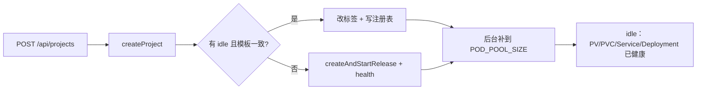

# Pod 池

创建项目时，请求路径上现做 PV、PVC、Service、Deployment，再轮询到 `/api/health`。本地这一段经常要几十秒，镜像不在节点上时会顶到 `waitForAgentHealth` 的 120 秒上限。

本方案把这段从 `POST /api/projects` 挪走：pod-server 后台维持少量已经健康的空闲 Pod，创建项目只是领走一只，并写上用户起的名字。做法对齐 Rush 的预热池（`/pod/api/pools/acquire` 领一只已经跑起来的 Pod），资源模型仍用现在的一项目一 Deployment。控制面已按本文落地，入口是 [`apps/pod-server/src/pool.ts`](../apps/pod-server/src/pool.ts)。

## 结论

用**预分配身份的热池**。空闲 Pod 在进池之前就有自己的 `projectId`，Deployment、Service、PVC、`PROJECT_ID` 都按这个 id 建好，并且 `/api/health` 已经返回 200。`createProject` 从池里取走这个 id，只补注册表里的名字和 `running` 状态。

不在领用时把一只匿名 Pod 改绑到用户指定的 id。当前 id 写死在四件事上，改任何一件都会让容器重启，慢路径又回到请求里：

| 绑定点 | 位置 |
|---|---|
| Deployment / Service 名 | `as-agent-<id>`（[`resources.ts`](../apps/pod-server/src/k8s/resources.ts)） |
| 标签与 Service selector | `agent-sandbox.project=<id>` |
| 工作区 | hostPath PV `volumes/<id>` |
| 进程身份 | 容器环境变量 `PROJECT_ID` |

Web 创建项目只提交 `name`，id 本来就是 pod-server 用 `nanoid` 生成的。池子提前生成 id，对外响应形状不变。

## 目标

- 池有库存时，`POST /api/projects` 在一次注册表写入内返回，不再等待调度和进程启动。
- 池空时退回今天的同步创建，创建仍然成功，只是慢。
- 停掉再 `ready`、删除项目、反代路径保持现状。
- `POD_POOL_SIZE=0` 时行为与现在一致，测试默认关池。

## 非目标

- 把 `stop` 之后的 Pod 缩成 0 再塞回池。工作区已经有对话和文件，不能当空闲沙盒。
- 领用失败后把 Pod「还回 idle」。第一版直接删掉，由补池再建。Rush 也是保守销毁，避免脏工作区回到池里。
- 多副本 pod-server 抢同一只空闲 Pod。控制面仍是单进程，池锁放在进程内。
- Ingress、镜像预拉 DaemonSet、按模板分多个池。本地镜像策略已经是 `IfNotPresent`。

`stop` → `ready` 仍是把 replicas 从 0 拉到 1，容器和 Node 进程要重新起来。池只去掉**第一次**创建的等待。

## 请求路径



有库存时用户看到的耗时是改一个标签加写 `projects.json`。建对象和等 health 发生在上一次补池，或者发生在 pod-server 启动之后。

## 空闲 Pod 长什么样

每只空闲 Pod 就是今天 `createAndStartRelease` 造出来的那一套，多两个标签：

| 标签 | 值 |
|---|---|
| `agent-sandbox.pool` | `creating` 或 `idle` |
| `agent-sandbox.template` | 当前期望规格的哈希 |

规格哈希覆盖镜像、启动命令、卷挂载。计算方式复用 [`deploymentNeedsReconcile`](../apps/pod-server/src/k8s/runtime.ts) 里已经在比的那几项（image、command、volumeMounts、volumes）。

空闲 Pod **不进** `registry/projects.json`。项目列表只读注册表，所以池成员不会出现在 Web 上。Service 仍然在，知道 id 就能访问 `/p/:id/agent`；id 是 12 位 nanoid，列表接口不泄露。

`PROJECT_ID`、工作区目录、Service DNS 从创建起就是最终值。领用后 Agent 不用重启，health 里的 `projectId` 也不变。

本地开了 `AGENT_DEV_ROOT` 时，空闲 Pod 用同一套只读源码挂载和 `dev-supervisor`。领用时不再 replace Deployment，避免一次滚动更新。

## 状态

集群标签是事实来源。`registry/pool.json` 只做重启后的索引，丢了可以从标签重建。

| 状态 | 标签 | 注册表 | 含义 |
|---|---|---|---|
| `creating` | `agent-sandbox.pool=creating` | 无项目记录 | 对象已提交，health 未过 |
| `idle` | `agent-sandbox.pool=idle` | 无项目记录 | 可被领用 |
| 已领用 | 去掉 pool 标签 | `projects.json` 有记录，`status=running` | 普通项目 |
| 冷创建中 | 无 pool 标签 | `status=pending` | 池空时的现有路径 |

领用是一次进程内互斥：

1. 选出一只 `idle`、replicas 就绪、模板哈希等于当前规格、并且 `GET /api/health` 仍为 200 的 Pod。
2. 去掉 `agent-sandbox.pool`。这一步成功之后它不再可被第二次领用。
3. `upsertProject`：id 用这只 Pod 的 id，`name` 用请求体，`status=running`。
4. 释放锁，异步补池。

第 3 步失败时删掉这套 Deployment / Service / PV / PVC，不把标签改回 `idle`。工作区只被 mkdir 过、没有用户数据，删掉比重置标签更简单。

## 补池与对账

pod-server 监听端口之后启动一次对账，之后每次领用或冷创建结束再补到 `POD_POOL_SIZE`。单进程里用同一把锁，避免两路补池各建一套。

对账规则：

- 标签是 `idle` 或 `creating`、注册表里没有这个 id：保留，继续等 health。health 通过后把标签改成 `idle`。
- 同名 id 已经在 `projects.json`：这是用户项目，清掉残留的 pool 标签，绝不纳入库存。
- 模板哈希不一致：删除这套资源，另建新的。不在空闲 Pod 上 replace。replace 会滚动重启，库存会在请求到来时变成不可用。
- `creating` 超过 3 分钟仍不健康：删除并计入失败，下一轮再补。
- 库存（`creating` + `idle`）小于目标：按差额调用现有的 `createAndStartRelease`，打上 `creating`。

`POD_POOL_SIZE` 默认 **1**。本地 OrbStack 上多一只常驻 Agent（request 100m CPU / 256Mi 内存，limit 2Gi）就够把下一次创建变成领用。默认不把笔记本铺满。测试和显式关闭时设 `0`，对账会删掉剩余空闲 Pod，已领用的项目不动。

## 和现有生命周期的关系

| API | 池 |
|---|---|
| `POST /api/projects` | 先领用；没有可领的再同步创建。响应仍是 `{ project }`，id 可能是池里预分配的 |
| `GET /api/projects/:id/ready` | 只针对注册表里的项目。停掉的项目 scale 到 1，不从池里换一只新的 |
| `POST /api/projects/:id/stop` | scale 到 0。项目还在，Pod 不回池 |
| `DELETE /api/projects/:id` | 删 Deployment / Service / PVC / PV 和宿主目录。不回池，补池另建新 id |
| 反代 `/p/:id/*` | 不变，仍然打到 `as-agent-<id>` 的 ClusterIP |

`GET /health` 增加池的可观测字段，方便确认后台是否真的有库存：

```json
{
  "status": "ok",
  "runtime": "kubernetes",
  "pool": { "target": 1, "idle": 1, "creating": 0 }
}
```

`idle` 只计模板匹配且 health 通过的数量。`creating` 是已提交、还不能领的数量。

## 失败

| 情况 | 行为 |
|---|---|
| 池里没有 idle | 走现有 `createAndStartRelease` + `waitForAgentHealth`，`projects.json` 先写 `pending` |
| 领用前 health 失败 | 这只标为废弃并删除，锁内再试下一只；都没有则冷创建 |
| 领用后注册表写失败 | 删除该 Release，返回 500。用户可以重试，下一次会领新的或冷创建 |
| 补池失败 | 记日志，不影响已经返回的创建。下一轮对账再补 |
| 镜像缺失 | 与现在相同：冷路径和补池都在 health 阶段失败，并提示 `pnpm k8s:load-agent`。不把 `ImagePullBackOff` 的 Pod 标成 idle |

并发创建：锁内第一笔拿走唯一的 idle，第二笔看到空池，走冷路径。补池是异步的，不让第二笔请求堵住等新 Pod 进池。

## 配置

| 变量 | 默认 | 作用 |
|---|---|---|
| `POD_POOL_SIZE` | `1` | 目标库存（`creating` + `idle`）。`0` 关闭并清掉空闲 Pod |

不增加新的超时。进池仍用现有的 health 轮询（1 秒间隔，上限 120 秒）。

## 落地位置

- [`apps/pod-server/src/pool.ts`](../apps/pod-server/src/pool.ts) — 领用、补池、对账、模板哈希。新建。
- [`apps/pod-server/src/projects.ts`](../apps/pod-server/src/projects.ts) — `createProject` 先 `pool.acquire()`，没有再走现在的冷路径。
- [`apps/pod-server/src/k8s/runtime.ts`](../apps/pod-server/src/k8s/runtime.ts) — Deployment 模板加上 pool / template 标签；抽出「按 id 创建一套 Release」供补池调用。
- [`apps/pod-server/src/index.ts`](../apps/pod-server/src/index.ts) — 启动对账；`/health` 带上池计数。
- `registry/pool.json` — `{ "slots": [{ "id", "state", "templateHash", "createdAt" }] }`。

`ready` / `stop` / `delete` 不改控制流。

## 验收

- `POD_POOL_SIZE=0`：创建仍同步等 health，行为与现在一致。
- 预先有一只 idle：`POST /api/projects` 返回的 id 等于这只 Pod 的 id，`/health` 里 `idle` 先变 0；项目列表只有这一条，没有池成员。
- 连续两次创建：第一次领用，第二次在补池完成前走冷路径并且成功。
- 改 `AGENT_IMAGE` 或 `AGENT_DEV_ROOT` 后对账：旧 idle 被删，新 idle 用新规格；领用不会把旧模板交出去。
- 删除项目后，原 id 不再出现在池里；新补上的是另一个 id。
- `stop` 再 `ready` 仍唤醒原来的 Deployment，不换池中的另一只。
